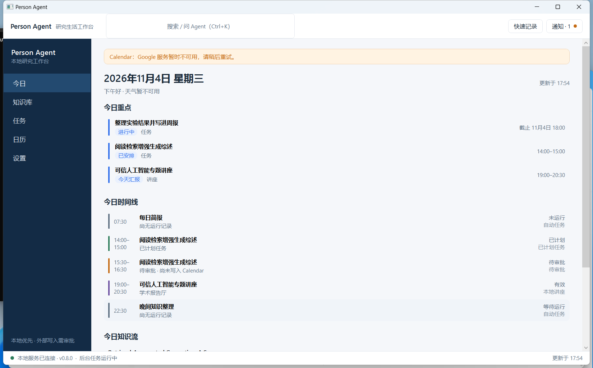

<p align="center">
  简体中文 · <a href="./README_EN.md">English</a>
</p>

<!-- README_SYNC: source=working-tree; updated=2026-11-04 -->

<div align="center">

# Person Agent

### 把邮件、日历、论文和任务，整理成一条能执行、可回溯的研究时间线

[](./CHANGELOG.md)
[](./package.json)
[](./client/PersonAgent.Desktop/PersonAgent.Desktop.csproj)
[](./test)
[](./start-client.cmd)

**Windows 10/11 · 单用户 · 本地优先 · 写外部系统必须先审批**



<sub>今日页（演示数据库）。本地数据照常显示；Calendar 未连接时顶部明确标记为 partial，不阻断其它模块。</sub>

</div>

## 这是什么

Person Agent 是一个面向研究生的 Windows 原生工作台。它只读 Gmail 找出待办，读 Google Calendar 计算空闲时段，把 Zotero 新论文整理进 Obsidian，并在你确认之后才写入日历。

它不是聊天机器人。日常界面是 WPF 客户端，领域数据在本地 SQLite 与 Obsidian 里；模型负责判断和表达，外部写入由确定性代码加审批门控执行。关闭浏览器、关掉终端也能用。

> 当前版本 **0.8.2**。这是个人项目，由作者维护。本地 **121 项 Node 测试**与 **8 项桌面合同测试**通过。

## 手工流程 vs Person Agent

| 环节 | 手工做法 | Person Agent |
| --- | --- | --- |
| 找线索 | 翻邮件、翻群消息、翻笔记 | Agent 只读检索 Gmail，保留 message ID，转成 `draft` 任务 |
| 排时间 | 对着日历手工数空档 | 确定性算法合并日程、讲座和已计划任务，给出候选时段 |
| 写日历 | 直接新建事件 | 先生成固定 payload 的待审批操作，确认后才写入 |
| 冲突 | 事后才发现撞车 | 后台比对事件，标记 `needs_replan` 并推送通知深链 |
| 读论文 | 手动记摘要、手动归档 | Zotero 增量同步，每晚深读最多 5 篇，写进 Obsidian 受管区块 |

## 核心差异

这五个能力都能在仓库里找到对应实现和测试：

1. **外部写入不可绕过审批。** Calendar 创建与修改先落成 `workflow_actions` 固定 payload，用户确认后才执行；执行时参数与快照不一致会被拒绝。
2. **排期是可恢复的持久工作流。** `task.schedule` 由 `workflow_runs` / `workflow_steps` 承载，服务重启、worker 重启或审批在关闭期间完成都不会丢状态，也不会重复写入。
3. **Agent 会话跨重启继续。** 消息存 SQLite；每次请求按 token 预算裁剪，先放系统规则、历史摘要和已确认长期记忆，再放最近消息。
4. **长期记忆可查、可改、可删。** 只有你明确要求记住的内容才会写入；删除后立即从上下文消失。
5. **工具权限是静态表。** 每个工具声明风险等级与审批方式，未登记的工具无法执行，提示词改不了这条规则。

## 快速开始

前置条件：Node.js 22.19+、pnpm、.NET 8 SDK（运行客户端还需要 .NET 8 Desktop Runtime）。

```powershell
pnpm install
pnpm build
pnpm link --global
person-agent setup
```

`setup` 会引导你录入 Google OAuth 客户端 JSON、DeepSeek key、知识库目录和晚间整理时间。Key 用当前 Windows 用户的 DPAPI 加密保存在本地，不写明文。

然后启动客户端：

```powershell
start-client.cmd
```

`start-client.cmd` 会自动使用仓库内的 `.dotnet`；缺少 `dist/src/cli.js` 或 Debug 客户端时会先构建。也可以双击桌面或开始菜单里的 `Person Agent` 快捷方式。

开发时不必全局链接：

```powershell
pnpm dev -- setup
pnpm dev -- chat
```

### Google OAuth 准备

1. 在 Google Cloud Console 建项目，启用 Gmail API 与 Google Calendar API。
2. 配置 OAuth consent screen，把自己的账号加入测试用户。
3. 创建 Desktop app OAuth client，下载客户端 JSON。
4. 运行 `person-agent setup`，填入 JSON 路径并在浏览器完成授权。

只申请三个 scope：`gmail.readonly`、`calendar.events`、`calendar.calendarlist.readonly`。旧版本只授权过 `calendar.readonly` 的，需要重新跑一次 `setup` 才能写日历事件。

### 后台任务（可选）

```powershell
person-agent worker install
person-agent worker status
```

计划任务会注册登录自启动并每 5 分钟重复触发，进程意外退出后最多 5 分钟自动恢复。它负责 07:30 的晨间简报、22:30 的知识整理，以及已计划任务的日历变化监控。

## 日常怎么用

客户端只有五个入口，`Ctrl+K` 是搜索、追问 Agent 和快速记录的统一入口。

| 入口 | 你能做什么 |
| --- | --- |
| 今日 | 看今日重点、时间线、知识流和待审批卡；开始或完成任务，批准或拒绝外部写入 |
| 知识库 | 按状态筛选论文，看分析依据，跳转 Zotero / Obsidian，手动同步与整理 |
| 任务 | 待安排 / 已计划 / 最近完成分组，编辑、开始、完成、取消，查候选时段并生成审批 |
| 日历 | 一周七列，聚合 Google 日程、本地讲座、已计划任务和待审批时段 |
| 设置 | 连接状态、自动化开关、长期记忆（新增 / 编辑 / 删除）、知识库路径与时区 |

`Ctrl+K` 面板里，库内搜索结果和 Agent 回答分区展示；回答下方带引用标签，点击可跳到对应的任务、论文、讲座或 Idea。

## 一条完整工作流

在客户端里描述需求，或在 `person-agent chat` 里直接输入：

```text
检查导师最近一周的邮件，把明确要求我完成的事项保存为任务；
结合本周日历安排到空闲时间，不要占用组会，写入日历前让我确认。
```

Agent 与确定性代码的分工：

1. 只读检索 Gmail，保留 message ID，把不明确的任务先追问清楚。
2. 保存可逆的 `draft` 任务，不用一句话就把它塞进日历。
3. 用固定算法合并 Calendar、讲座和已计划任务，计算工作时段。
4. 对选定时段生成待审批操作，展示固定 payload。
5. 你在“今日 → 待审批”确认后才写入；拒绝就放弃。
6. 后台发现事件被删或时间冲突时，任务变成 `needs_replan`，重新走候选时段与审批。

## 架构

```text
WPF 客户端 (client/PersonAgent.Desktop, .NET 8)
        │ loopback HTTP + 一次性 session token
        ▼
本地服务 (src/server, 只监听 127.0.0.1)
        │
        ├── Agent 会话 / Context Builder / 长期记忆 (src/agent)
        ├── Workflow Run (src/workflows) ── workflow_actions 审批
        ├── 知识管线 (src/knowledge) ── Zotero 只读, Obsidian 写入
        ├── SQLite (node:sqlite, WAL)
        └── Google API (Gmail 只读, Calendar 审批后写)

后台 worker (Windows 计划任务) ── 复用同一批领域函数
```

客户端不直接读数据库、Markdown 或凭据；接口层只做输入输出转换、鉴权和错误映射，不复制领域规则。

## 数据与安全边界

- 本地服务只监听 `127.0.0.1`，每次客户端启动生成一次性 session token，浏览器来源请求被直接拒绝。
- OAuth token 与 DeepSeek key 用 DPAPI 加密存储；`doctor` 只报告是否配置，不输出密钥。
- Gmail 与 Zotero 全程只读；Zotero 只调本地 API，不联网补论文，不扫描下载文件夹。
- Calendar 写入无法绕过审批；待审批时段不会伪装成已写入事件。
- 论文全文与摘要按不可信数据处理，深读走无工具的独立模型调用，正文不能触发工具或改系统指令。
- 会话、长期记忆、审批记录和工作流状态都落在本地 SQLite，可随时删除；删除后不再被上下文读取。

## 验证

```powershell
pnpm run typecheck
pnpm test
pnpm test:desktop
pnpm build
```

- Node 测试 121 项：任务状态机、审批门控、候选时段、冲突重排、Obsidian 区块幂等、Zotero 分页与降级、会话往返与重启恢复、上下文预算与摘要、长期记忆、工作流等待与恢复、工具权限、引用复核，以及本地 API 的鉴权、降级与 `serve` 启停。
- 桌面合同测试 8 项：深链参数、协议 URI、单实例 payload、客户端登记文件，以及会话、回答、引用与记忆的 DTO 解析。
- 另有 20 条真实模型场景评测（`pnpm run eval:agent`），会实际调用 DeepSeek，不在普通 `pnpm test` 里跑。

## 已知限制

- 工作记忆、按任务检索证据、语义记忆检索还没有实现；上下文只按预算与重要度组装。
- 只有 `task.schedule` 一个 workflow 迁移到可恢复运行时，知识同步/整理仍走原有 `operations`。
- 等待中的 workflow 没有客户端列表，只能通过 API 与服务端日志查看。
- 高 DPI 125%–200% 尚未逐档人工验收；发布方式（MSIX 或安装器）未定。
- 仓库目前没有 `LICENSE` 文件。

## 文档

- [产品设计与能力边界](./PRODUCT_DESIGN.md)
- [系统架构](./docs/01-system-architecture.md) · [领域数据模型](./docs/03-domain-data-model.md) · [UI 数据合同](./docs/04-ui-data-contract.md) · [Agent 技术栈](./docs/05-agent-technology-stack.md)
- [本地 API 合同](./docs/api/openapi.yaml) · [更新日志](./CHANGELOG.md) · [第三方致谢](./THIRD_PARTY_NOTICES.md)

## 维护状态

项目由一人维护。修改代码后，请至少跑通 `pnpm run typecheck`、`pnpm test` 和 `pnpm test:desktop`。
