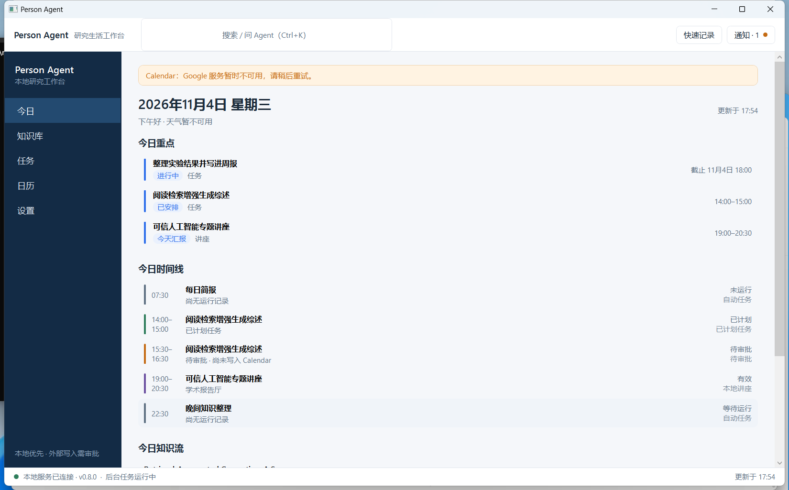

<p align="center">
  <a href="./README.md">简体中文</a> · English
</p>

<!-- README_SYNC: source=working-tree; updated=2026-11-04 -->

<div align="center">

# Person Agent

### Turn email, calendar, papers and tasks into one timeline you can actually execute

[](./CHANGELOG.md)
[](./package.json)
[](./client/PersonAgent.Desktop/PersonAgent.Desktop.csproj)
[](./test)
[](./start-client.cmd)

**Windows 10/11 · single user · local-first · external writes require approval**



<sub>Today page (demo database). Local data keeps rendering; when Calendar is unavailable the page is marked partial instead of failing as a whole.</sub>

</div>

## What it is

Person Agent is a native Windows workspace for graduate students. It reads Gmail to find follow-ups, reads Google Calendar to find free slots, files new Zotero papers into Obsidian, and only writes to your calendar after you approve.

It is not a chat bot. The daily interface is a WPF client; domain data lives in local SQLite and Obsidian. The model handles judgement and wording, while deterministic code plus an approval gate performs external writes. You do not need a browser or a terminal to use it.

> Current version **0.8.2**. This is a personal project with no public remote and no support commitment. Locally, **121 Node tests** and **8 desktop contract tests** pass.

## Manual workflow vs Person Agent

| Step | By hand | Person Agent |
| --- | --- | --- |
| Find follow-ups | Dig through email, chat history, notes | Agent searches Gmail read-only, keeps the message ID, saves a `draft` task |
| Find time | Count gaps against the calendar | Deterministic code merges events, lectures and planned tasks, then proposes slots |
| Write calendar | Create the event directly | Persists a fixed-payload approval first; writes only after you confirm |
| Conflicts | Discover the clash later | Background check marks the task `needs_replan` and sends a notification deep link |
| Read papers | Summarize and file by hand | Zotero incremental sync, up to 5 papers deep-read per night, written into managed Obsidian blocks |

## What makes it different

Each of these is implemented in the repository and covered by tests:

1. **External writes cannot skip approval.** Calendar create and update first become a fixed payload in `workflow_actions`. The write only runs after you confirm, and a payload that no longer matches the snapshot is rejected.
2. **Scheduling is a durable, resumable workflow.** `task.schedule` runs on `workflow_runs` / `workflow_steps`. A service restart, a worker restart, or an approval that finished while the service was down loses no state and does not write twice.
3. **Agent conversations survive restarts.** Messages live in SQLite; every request is trimmed to a token budget, with system rules, history summary and confirmed memories placed before the most recent messages.
4. **Long-term memory can be inspected, edited and deleted.** Only what you explicitly ask to remember is stored; deleting it removes it from the next prompt immediately.
5. **Tool permissions are a static table.** Every tool declares a risk level and an approval mode; unregistered tools cannot run, and prompts cannot change that rule.

## Quick start

Requirements: Node.js 22.19+, pnpm, the .NET 8 SDK (the client also needs the .NET 8 Desktop Runtime).

```powershell
pnpm install
pnpm build
pnpm link --global
person-agent setup
```

`setup` walks through the Google OAuth client JSON, the DeepSeek key, the knowledge vault path and the evening digest time. The key is encrypted with Windows DPAPI for the current user and never stored in plaintext.

Then start the client:

```powershell
start-client.cmd
```

`start-client.cmd` reuses the repository-local `.dotnet` and builds first when `dist/src/cli.js` or the Debug client is missing. You can also launch the `Person Agent` shortcut from the desktop or Start menu.

When working on the code you do not need a global link:

```powershell
pnpm dev -- setup
pnpm dev -- chat
```

### Google OAuth setup

1. Create a project in Google Cloud Console and enable the Gmail API and Google Calendar API.
2. Configure the OAuth consent screen and add your own account as a test user.
3. Create a Desktop app OAuth client and download the client JSON.
4. Run `person-agent setup`, provide the JSON path, and finish consent in the browser.

Only three scopes are requested: `gmail.readonly`, `calendar.events` and `calendar.calendarlist.readonly`. If an older install only granted `calendar.readonly`, run `setup` again to gain event write access.

### Background worker (optional)

```powershell
person-agent worker install
person-agent worker status
```

The scheduled task registers at logon and repeats every 5 minutes, so a crashed worker recovers within 5 minutes. It owns the 07:30 briefing, the 22:30 knowledge digest and calendar monitoring for planned tasks.

## Daily use

The client has exactly five entries, and `Ctrl+K` is the single entry for search, agent follow-ups and quick capture.

| Entry | What you do there |
| --- | --- |
| Today | Today's focus, timeline, knowledge flow and pending approvals; start or complete tasks, approve or reject external writes |
| Library | Filter papers by evidence state, read the analysis basis, open Zotero / Obsidian, trigger sync and digest |
| Tasks | Draft / planned / recently completed groups; edit, start, complete, cancel; list candidate slots and stage an approval |
| Calendar | One week, seven columns: Google events, local lectures, planned tasks and pending approval slots |
| Settings | Connection state, automation switches, long-term memory (add / edit / delete), vault path and timezone |

Inside `Ctrl+K`, library results and agent answers are shown in separate regions. Answers carry reference chips that jump to the matching task, paper, lecture or idea.

## One end-to-end flow

Describe the request in the client, or type it into `person-agent chat`:

```text
检查导师最近一周的邮件，把明确要求我完成的事项保存为任务；
结合本周日历安排到空闲时间，不要占用组会，写入日历前让我确认。
```

How the agent and deterministic code split the work:

1. Search Gmail read-only, keep the message ID, and ask before guessing an unclear task or deadline.
2. Save a reversible `draft` task instead of dropping it straight onto the calendar.
3. Merge calendar events, lectures and planned tasks with a fixed algorithm to compute working slots.
4. Stage an approval for the chosen slot and show its fixed payload.
5. Write only after you confirm under Today → Pending; reject and nothing happens.
6. If an event is deleted or a new meeting collides, the task becomes `needs_replan` and goes back through slots and approval.

## Architecture

```text
WPF client (client/PersonAgent.Desktop, .NET 8)
        │ loopback HTTP + one-time session token
        ▼
Local API server (src/server, listens on 127.0.0.1 only)
        │
        ├── Agent session / Context Builder / memory (src/agent)
        ├── Workflow runs (src/workflows) ── workflow_actions approval
        ├── Knowledge pipeline (src/knowledge) ── Zotero read-only, Obsidian write
        ├── SQLite (node:sqlite, WAL)
        └── Google API (Gmail read-only, Calendar after approval)

Background worker (Windows scheduled task) ── same domain functions
```

The client never touches the database, Markdown files or credentials directly. The API layer only translates input/output, enforces the loopback boundary and maps errors; it does not duplicate domain rules.

## Data and safety boundaries

- The local service binds to `127.0.0.1` only; each client start creates a one-time session token, and browser-origin requests are rejected outright.
- OAuth tokens and the DeepSeek key are encrypted with DPAPI; `doctor` only reports whether they are configured and never prints them.
- Gmail and Zotero are read-only. Zotero is accessed through its local API only: no web paper search, no download-folder scanning.
- Calendar writes cannot bypass approval, and a pending slot is never presented as an already-written event.
- Paper full text and abstracts are treated as untrusted data; deep reads use a separate tool-free model call, so text cannot trigger tools or rewrite system rules.
- Conversations, long-term memory, approvals and workflow state all live in local SQLite and can be deleted; deleted rows are never read into context again.

## Verification

```powershell
pnpm run typecheck
pnpm test
pnpm test:desktop
pnpm build
```

- 121 Node tests: task state machine, approval gate, candidate slots, conflict replanning, idempotent Obsidian blocks, Zotero paging and degradation, conversation round-trip and restart recovery, context budget and summaries, long-term memory, workflow waiting and recovery, tool policy, reference verification, plus API auth, degradation and `serve` lifecycle.
- 8 desktop contract tests: deep-link parsing, protocol URIs, single-instance payloads, the client registration file, and DTO parsing for conversations, answers, references and memories.
- Another 20 live-model scenario evaluations (`pnpm run eval:agent`) actually call DeepSeek and are excluded from the normal `pnpm test`.

## Known limitations

- Working memory, task-specific evidence retrieval and semantic memory search are not implemented; context is assembled by budget and importance only.
- Only `task.schedule` has moved to the durable workflow runtime; knowledge sync and digest still use the older `operations` path.
- Waiting workflow runs have no client-side list; they are visible through the API and server logs only.
- DPI scaling at 125%–200% has not been verified step by step, and packaging (MSIX or installer) is undecided.
- There is no `LICENSE` file, so no license badge is shown and no license has been chosen for you. Decide the terms before publishing.

## Documentation

- [Product design and capability boundaries](./PRODUCT_DESIGN.md)
- [System architecture](./docs/01-system-architecture.md) · [Domain data model](./docs/03-domain-data-model.md) · [UI data contract](./docs/04-ui-data-contract.md) · [Agent technology stack](./docs/05-agent-technology-stack.md)
- [Local API contract](./docs/api/openapi.yaml) · [Changelog](./CHANGELOG.md) · [Third-party notices](./THIRD_PARTY_NOTICES.md)

## Maintenance

This is a single-maintainer local project with no public remote and no issue tracker. Make changes directly in the repository and at minimum run `pnpm run typecheck`, `pnpm test` and `pnpm test:desktop`.
